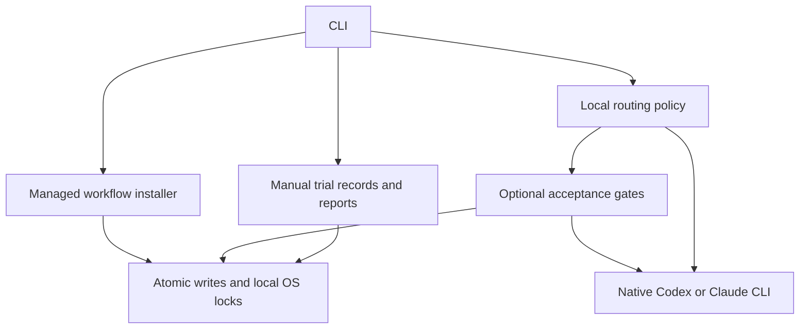

# Architecture

AgentLean is a Python command-line application with a standard-library runtime.
Its portable skill is data copied into a target project. It has no hosted service,
agent daemon, provider SDK dependency or automatic telemetry collector.

## Modules

| Path | Responsibility |
| --- | --- |
| `agentlean/cli.py` | Argument parsing, preview/execution boundary, output and exit codes |
| `agentlean/install.py` | Ownership manifests, guarded updates/removal and recovery journals |
| `agentlean/routing.py` | Config validation, conservative tier rules and native client arguments |
| `agentlean/quality.py` | Check snapshots, baseline/post-run checks, evidence and bounded repair |
| `agentlean/trials.py` | Manual observation validation and conservative matched-pair summaries |
| `agentlean/storage.py` | OS-backed advisory locks, strict JSON and atomic replacement |
| `agentlean/templates/` | Portable instructions installed as project-local assets |

## Stored state

| Target-project path | Contents |
| --- | --- |
| `.agentlean/install-PROFILE.json` | Owned workflow paths, version and SHA256 hashes |
| `.agentlean/install-transaction.json` | Before/after content for an interrupted installation |
| `.agentlean/routing.json` | Explicit on/off toggle and user-chosen model/effort presets |
| `.agentlean/trials.jsonl` | Versioned, manually supplied trial observations |
| `.agentlean/runs/RUN_ID/` | Check logs and checkpointed quality report |
| `.agentlean/*.lock` | Persistent sidecars used by live OS locks |

Install profiles add their own instruction files outside `.agentlean` when
appropriate. Native clients may keep separate session history. AgentLean does
not store the original run prompt or model response, though explicit check logs
can contain private data emitted by the commands you supply.

## Important boundaries

- Previews do not execute models or check commands. Only explicit write/execution
  actions cross that boundary.
- Routing selects configured presets; it cannot establish price, capability,
  account access or effective subscription usage from a model name.
- Quality success means configured checks passed, not proof of all requirements.
- Model/effort identity is part of a matched trial; different-model runs are not
  silently treated as equivalent workflow comparisons.
- Locks coordinate AgentLean writers on trusted local filesystems, not external
  editors, hostile path changes or arbitrary network-filesystem semantics.
- JSONL logs are loaded and rewritten as complete snapshots. This is intended
  for modest local experiment logs rather than high-volume telemetry.

See [security](../SECURITY.md), [tests](../tests/README.md) and
[the roadmap](roadmap.md) before changing these invariants.
